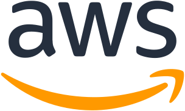

## About Me

Hi there! I'm **Xinyu Li** 👋 I am a Ph.D. candidate at the [Auton Lab](https://autonlab.org/) in the School of Computer Science at [Carnegie Mellon University](https://www.cmu.edu/), advised by Prof. [Artur Dubrawski](https://www.ri.cmu.edu/ri-faculty/artur-w-dubrawski/). Prior to my Ph.D., I obtained a B.S. in Computer Science (Information Security) from Shanghai Jiao Tong University and a Master of Information Systems Management (MISM) from Carnegie Mellon University.

Feel free to <a class="contact-link" href="mailto:xinyul2@andrew.cmu.edu">reach out</a> if you are interested in my research and would like to collaborate!

## Research Interests

My research focuses on making AI agents more accessible and useful in real-world applications through evaluation and post-training methods.







  

    01
    

      
Agent Evaluation

      
Building realistic and scalable benchmarks for evaluating the practical utility of AI agents.

      

        <a class="ri-paper" href="#pub-{{ p_tsgym.title | slugify }}">TimeSeriesGymICML'25 FMSD</a>
      

    

  

  

    02
    

      
Reasoning &amp; Personalization

      
Developing RL-based post-training methods to improve reasoning and adapt LLMs to diverse users and tasks.

      

        <a class="ri-paper" href="#pub-{{ p_notes.title | slugify }}">Notes to SelfEMNLP'26 Findings</a>
        <a class="ri-paper" href="#pub-{{ p_pfl.title | slugify }}">PFLNeurIPS'25 UniReps</a>
        <a class="ri-paper" href="#pub-{{ p_prlhf.title | slugify }}">P-RLHFNeurIPS'24 AFM</a>
      

    

  

  

    03
    

      
Agentic Capabilities

      
Developing agentic harnesses and learning frameworks for scalable long-horizon reasoning.

      

        <a class="ri-paper" href="#pub-{{ p_hermes.title | slugify }}">HermesNeurIPS'26 LCFM</a>
      

    

  

## News

- Sep 2026 Our preprint "Hermes: Learning Contextual Reasoning Unlocks Test-Time Scaling" is out! Check out the [project page](./blog/2026/hermes.html).
- May 2025 I start my Applied Scientist internship at Amazon in Palo Alto.
- Oct 2024 Our [Personalized RLHF](https://arxiv.org/abs/2402.05133) work is accepted to [NeurIPS 2024 Workshop on Adaptive Foundation Models](https://adaptive-foundation-models.org/index.html).

  Show more
  Show less
  <svg width="12" height="12" viewBox="0 0 16 16" fill="none"><path d="M3 6l5 5 5-5" stroke="currentColor" stroke-width="2" stroke-linecap="round" stroke-linejoin="round"/></svg>

<ul>
<li>Jun 2024 I give an invited talk on our <a href="https://arxiv.org/abs/2402.05133">Personalized RLHF</a> work at Mila RLHF reading group.</li>
<li>Jun 2024 I start my internship at the <a href="https://www.microsoft.com/en-us/research/group/biomedical-imaging/">Biomedical Imaging team</a> at Microsoft Research Cambridge.</li>
</ul>



## Experiences

  

    
    

      

        
Amazon Web Services (AWS)

        
Applied Scientist Intern

        

          📍 Seattle, WA, USA
          🗓️ May – Aug 2026
          Manager: <a href="https://scholar.google.com/citations?user=Uz_5hUsAAAAJ&hl=en" target="_blank">Purak Jain</a>
          Mentor: <a href="https://scholar.google.com/citations?user=TgQ72t0AAAAJ&hl=en" target="_blank">Mononito Goswami</a>
        

      

      

    

  

  

    
    

      

        
Amazon

        
Applied Scientist Intern

        

          📍 Palo Alto, CA, USA
          🗓️ May – Dec 2025
          Manager: <a href="https://scholar.google.com/citations?user=zmdnXmMAAAAJ&hl=en" target="_blank">Rohit Patki</a>
          Mentor: <a href="https://scholar.google.com/citations?user=P9zFscUAAAAJ&hl=en" target="_blank">Mike Morais</a>
        

      

      

    

  

  

    
    

      

        
Microsoft Research

        
Research Intern

        

          📍 Cambridge, UK
          🗓️ Jun – Aug 2024
          Manager: <a href="https://scholar.google.com/citations?user=mvk_WocAAAAJ&hl=en" target="_blank">Shruthi Bannur</a>
          Mentor: <a href="https://scholar.google.com/citations?user=UT-RATkAAAAJ&hl=en" target="_blank">Daniel C. Castro</a>
        

      

      

    

  

